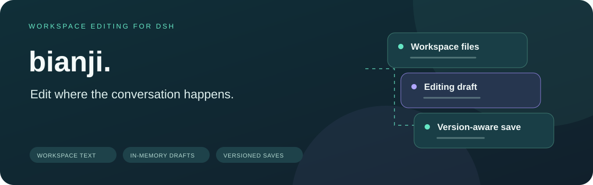
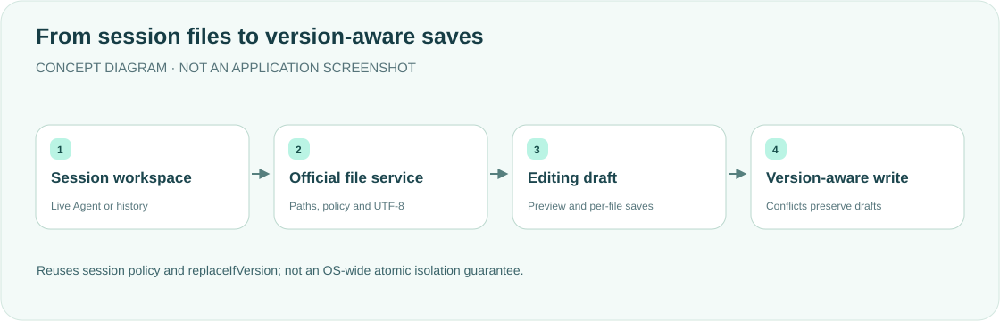

<div align="center">

<h1>bianji · Workspace editor</h1>
<p><strong>Edit beside the conversation. Keep your workspace and drafts connected.</strong></p>
<p>A file tree, Monaco editing and Markdown preview in the DeepSeek Harness desktop sidebar.</p>
<p><a href="README.md">简体中文</a> · <strong>English</strong></p>
<p><a href="package.json">v0.1.2</a> · <a href="LICENSE">MIT</a> · DSH desktop plugin</p>
<p><a href="#features">Features</a> · <a href="#how-it-works">How it works</a> · <a href="#quick-start">Quick start</a> · <a href="#saving-and-boundaries">Saving and boundaries</a> · <a href="#validation">Validation</a></p>
</div>

---

A desktop plugin tailored to a personal workflow. Treat it as a reference and verify compatibility before copying it to another DSH version. It keeps its own `kind: bianji`, does not replace the official file panel and is not the native macOS Edit menu. Checked against desktop **0.2.2-alpha.2**.

## Features

<table><tr>
<td width="33%"><strong>🗂 Workspace tree</strong><br/><br/>Resolve files from the current session and open them beside the conversation, without starting an Agent to inspect history. Hides <code>node_modules</code> / <code>.git</code> by default and can filter by filename.</td>
<td width="33%"><strong>✍️ Editing and preview</strong><br/><br/>Monaco and a restricted Markdown preview, with a line-numbered text-area fallback if Monaco is unavailable.</td>
<td width="33%"><strong>🧾 Version-aware writes</strong><br/><br/>Read a version and save through the official replaceIfVersion service. Conflicts pause autosave, not discard drafts.</td>
</tr><tr>
<td><strong>🔗 Conversation references</strong><br/><br/>Add to chat, copy a path, reveal in Finder or drag into the composer as an @reference.</td>
<td><strong>💾 Per-file autosave</strong><br/><br/>Preserve newer edits during in-flight saves; copy local content before reloading a failed or conflicted file.</td>
<td><strong>🛡 Session policy</strong><br/><br/>Constrain operations to the workspace and reuse official filesystem services and that session's sandbox permissions.</td>
</tr></table>

## How it works



The workspace comes from a live Agent first; an attached Session without an Agent uses `sessions.get`; cold history uses official `sessionQuery.observeSession` (`projectionMode: "none"`, disposed after the read). Older hosts that still expose `sessionController.inspect` remain a fallback. Saving resolves policy again and uses the official filesystem and version lock—not direct arbitrary disk writes from the Client.

## Quick start

Requires the official DeepSeek Harness desktop application and compatible APIs. This is a desktop filesystem plugin, not a standalone web application. Load it as a **profile bundle**; do not also insert the same id in desktop `cordis.patch.yml`.

```sh
export DSH_HOME="${DSH_HOME:-$HOME/.dsh}"
git clone https://github.com/yueyexiayu/dsh-bianji.git "$DSH_HOME/plugins/bianji"
```

1. Add `"bianji": "link:$DSH_HOME/plugins/bianji"` to `$DSH_HOME/profiles/desktop/package.json` `dependencies`
2. Add the string `"bianji"` to the same file's `dsh.profile.bundles`
3. Install that profile's dependencies and confirm `node_modules/bianji` links to the plugin

**Quit DSH fully with ⌘Q and reopen it.** Open the editor from the sidebar's start page. Updating files does not prove the running Host has reloaded them.

## Saving and boundaries

- Reads and writes stay inside the session workspace `cwd`. Missing sessionId / absolute cwd (including relative cwd) returns 400; unknown session 404; unavailable inspection 503; corrupt history 500. Errors do not become an empty workspace.
- Strict UTF-8: binary, non-UTF-8 input such as GBK, and oversized files fail explicitly. BOM and line endings are preserved. Saves reject NUL, lone surrogates and unsupported control bytes.
- POSIX backslashes remain filename characters. Paths and actual targets must remain inside the workspace. Checks reject reproduced symlink-replacement escapes, but are not kernel-level atomic isolation.
- Cold history uses an unpublished `sessions.prepare` snapshot to restore its permissions, without creating/resuming an Agent or inheriting permissive Host policy. Missing policy/version services deny saves.
- External writes, replacement or deletion conflict with an old version. Deleted files are not recreated. Drafts survive conflict and failed saves; reloading requires confirmation before discarding local edits.
- Reloading locks save/close; editing during a read cancels obsolete reload results. Per-session drafts live in Client memory: **refreshing, fully quitting or disabling the plugin loses them**. Save or copy first.
- Version checks share the official AI tools' filesystem instance and write lock. They are not an OS-wide conditional write; another editor can still write between the check and atomic replacement.
- Markdown emits escaped restricted tags and HTTP(S) links, not executable raw HTML. Finder and directory failures remain visible. Write/reveal requests share the 15s timeout used for directory reads.
- No installer, accounts or credentials.

## Validation

```sh
cd "$DSH_HOME/plugins/bianji"
for file in lib/*.js; do node --check "$file" || exit 1; done
node --test
```

Tests may skip unavailable installed-runtime/browser environments. A skip is not a pass.

<details>
<summary><strong>Official filesystem and browser test notes</strong></summary>

The installed-runtime integration creates temporary files and does not modify the official package:

```sh
BIANJI_OFFICIAL_RUNTIME='/Applications/DeepSeek Harness.app/Contents/Resources/app.asar/dsh' \
ELECTRON_RUN_AS_NODE=1 '/Applications/DeepSeek Harness.app/Contents/MacOS/DeepSeek Harness' \
  --test test/official-fs.test.mjs
```

Ordinary Node can also use `BIANJI_OFFICIAL_RUNTIME` pointing to a read-only extracted reference. `test/client-security.test.mjs` requires Playwright, React/ReactDOM 18 UMD and a matching Chromium headless shell, configured by `BIANJI_PLAYWRIGHT_MODULE`, `BIANJI_CHROMIUM_EXECUTABLE`, `BIANJI_REACT_UMD` and `BIANJI_REACT_DOM_UMD`. Do not substitute the user's Chrome or a full Chrome.app for windowless validation.

On 2026-10-29 against desktop **0.2.2-alpha.2**, `SessionController.inspect` is gone and cold history uses `sessionQuery.observeSession`. Unit tests: 87 passed. Official Electron integration: 20 passed. Browser XSS cases skipped here without Playwright/React UMD and are not a pass. This is not end-to-end proof that the latest desktop Host was reloaded with ⌘Q.

</details>

## Updates and license

Save in-memory drafts before updating. Uninstall by removing `bianji` from the desktop profile `dependencies` and `dsh.profile.bundles`; do not empty the whole patch. Then fully restart DSH. This repository includes no account credentials or general installer. Source is [MIT-licensed](LICENSE).

<div align="center"><sub>Clear edits. Accountable saves. · <a href="README.md">阅读中文版 →</a></sub></div>
