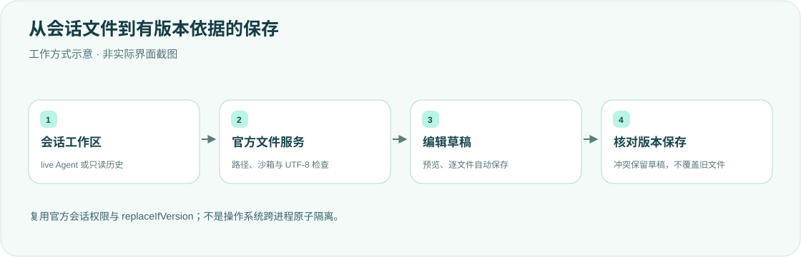

<div align="center">

<h1>bianji · 工作区编辑器</h1>
<p><strong>在对话旁编辑文件，让草稿与工作区保持连贯。</strong></p>
<p>DeepSeek Harness 桌面端右侧栏的文件树、Monaco 编辑与 Markdown 预览。</p>
<p><strong>简体中文</strong> · <a href="README.en.md">English</a></p>
<p><a href="package.json">v0.1.3</a> · <a href="LICENSE">MIT</a> · DSH desktop plugin</p>
<p><a href="#核心能力">核心能力</a> · <a href="#工作方式">工作方式</a> · <a href="#快速开始">快速开始</a> · <a href="#保存与边界">保存与边界</a> · <a href="#验证">验证</a></p>
</div>

---

面向个人桌面工作流的文件编辑插件，可供参考，不建议未经核对直接照搬到其他 DSH 版本。它保留独立 `kind: bianji`，不替换官方文件面板，也不是 macOS 原生 Edit 菜单。已针对本机桌面 **0.2.2-alpha.2** 核对。

## 核心能力

<table><tr>
<td width="33%"><strong>🗂 工作区文件树</strong><br/><br/>从当前会话解析工作区，浏览文件并在右侧打开；不为读取历史会话启动 Agent。默认隐藏 <code>node_modules</code> / <code>.git</code>，可过滤文件名。</td>
<td width="33%"><strong>✍️ 文本与预览</strong><br/><br/>Monaco 编辑、受限 Markdown 预览；图片/音视频/PDF 只读查看；docx/pptx/xlsx 抽文本或表格预览。不在此编辑二进制或 Office 原件。</td>
<td width="33%"><strong>🧾 版本保护</strong><br/><br/>读取版本并使用官方 replaceIfVersion 保存，冲突暂停自动保存而不丢弃草稿。</td>
</tr><tr>
<td><strong>🔗 对话引用</strong><br/><br/>右键添加到对话、复制路径、访达打开，或拖到输入框插入 @引用。</td>
<td><strong>💾 独立自动保存</strong><br/><br/>逐文件安排保存，在途输入保留最新草稿；失败或冲突可复制本地内容后重载。</td>
<td><strong>🛡 会话策略</strong><br/><br/>读写限定在当前工作区，并复用官方文件服务和该会话的沙箱权限。</td>
</tr></table>

## 工作方式



工作区优先来自 live Agent；已 attached、无 Agent 的 Session 走 `sessions.get`；冷历史走官方 `sessionQuery.observeSession`（`projectionMode: "none"`，读完即 dispose）。旧 Host 若仍有 `sessionController.inspect` 则作为兜底。保存重新解析权限，经官方文件服务及版本锁执行；不是由 Client 直接写任意磁盘路径。

## 快速开始

需要 DeepSeek Harness 官方桌面端及与其 API 兼容的环境。源码是桌面文件系统插件，不是独立网页应用。按 **profile bundle** 加载，不要再往 desktop `cordis.patch.yml` insert 同一 id。

```sh
export DSH_HOME="${DSH_HOME:-$HOME/.dsh}"
git clone https://github.com/yueyexiayu/dsh-bianji.git "$DSH_HOME/plugins/bianji"
```

1. `$DSH_HOME/profiles/desktop/package.json` 的 `dependencies` 加 `"bianji": "link:$DSH_HOME/plugins/bianji"`
2. 同一文件的 `dsh.profile.bundles` 加字符串 `"bianji"`
3. 在该 profile 目录安装依赖，确认 `node_modules/bianji` 链到插件目录

**⌘Q 完全退出 DSH 后重开**，展开右侧栏，在「开始」中打开「编辑器」。更新源码不等于正在运行的 Host 已重载。

## 保存与边界

- 读写限制在当前会话工作区 `cwd` 内。缺少 sessionId / 绝对 cwd（含相对 cwd）返回 400，未知会话 404，缺少检查服务 503，持久化读取或损坏错误 500；不会用空工作区掩盖错误。
- 严格 UTF-8：二进制、GBK 等非 UTF-8 及过大文件明确拒绝。不删除 BOM，不自动转换编码或换行；保存拒绝 NUL、孤立 surrogate 和不支持的控制字节。
- POSIX 文件名中的 `\` 保持原义；路径和真实目标需处于工作区内。检查能拒绝已复现的 symlink 替换越界，不是内核级原子隔离。
- 冷历史使用未发布的 `sessions.prepare` 快照恢复该会话的权限，不 create/resume Agent，不继承 Host 的宽松权限。缺少策略或文件版本服务时拒绝保存。
- 外部改写、替换或删除会使旧版本保存冲突；不重建已删除文件。冲突保留草稿，重新加载需确认丢弃未保存内容；保存失败时关闭标签不会丢稿。
- 重载期间锁定保存与关闭，读取期间继续编辑会取消过期结果。草稿在客户端内存中按会话保留，**刷新客户端、完全退出或停用插件后不保留**，请先保存或复制。
- 版本检查与官方 AI 文件工具共用实例/写入锁，但不是操作系统跨进程条件写入；其他编辑器仍可能恰好在检查后、替换前写入。
- Markdown 仅生成转义后的受限标签和 HTTP(S) 链接，不执行原始 HTML。访达启动和目录请求失败会明确显示。保存/访达请求与目录读取一样 15 秒超时。
- 不包含安装器、账号或凭据。

## 验证

```sh
cd "$DSH_HOME/plugins/bianji"
for file in lib/*.js; do node --check "$file" || exit 1; done
node --test
```

测试可能跳过缺少官方安装包/浏览器环境的项；跳过不能计为通过。

<details>
<summary><strong>官方文件服务与浏览器测试说明</strong></summary>

安装包内的真实文件服务回归只创建临时文件，不修改官方包：

```sh
BIANJI_OFFICIAL_RUNTIME='/Applications/DeepSeek Harness.app/Contents/Resources/app.asar/dsh' \
ELECTRON_RUN_AS_NODE=1 '/Applications/DeepSeek Harness.app/Contents/MacOS/DeepSeek Harness' \
  --test test/official-fs.test.mjs
```

也可在普通 Node 中以 `BIANJI_OFFICIAL_RUNTIME` 指向只读解包参考。`test/client-security.test.mjs` 需要实际 Playwright、React/ReactDOM 18 UMD 和匹配的 Chromium headless shell；配置键为 `BIANJI_PLAYWRIGHT_MODULE`、`BIANJI_CHROMIUM_EXECUTABLE`、`BIANJI_REACT_UMD`、`BIANJI_REACT_DOM_UMD`。不要用用户 Chrome 或完整 Chrome.app 冒充无窗口验收。

2026-10-29 对照本机桌面 **0.2.2-alpha.2**：官方 `SessionController.inspect` 已不存在，冷历史改为 `sessionQuery.observeSession`。单元测试 87 通过；官方 Electron 集成 20 通过。浏览器 XSS 用例在本机未安装 Playwright/React UMD 时跳过，不能计为通过。这不等于已 ⌘Q 重开后的桌面端到端可见性验收。

</details>

## 更新与许可

更新前保存内存草稿；卸载从 desktop `package.json` 的 `dependencies` 与 `dsh.profile.bundles` 去掉 `bianji`，不要清空整份 patch。然后完全重启 DSH。仓库不包含账号、凭据或通用安装器。源码采用 [MIT License](LICENSE)。

<div align="center"><sub>编辑清楚，保存有据。 · <a href="README.en.md">Read in English →</a></sub></div>
